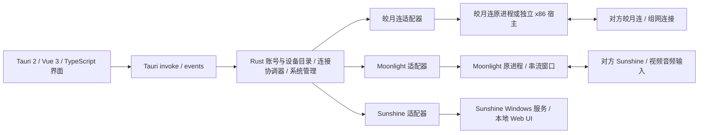

# LL远程 · 软件方案

**版本：V1.3　｜　日期：2026-11-21　｜　阶段：开发前方案**

LL远程是一款 Windows 电脑之间使用的远程控制软件。用户在一个界面中登录皎月连、查看设备、建立网络连接并进入远程桌面；后台继续使用皎月连、Sunshine 和 Moonlight 的现有内核。

产品界面以用户提供的 UU 远程截图为参考，采用蓝灰配色、左侧设备导航、右侧设备详情和大幅“进入桌面”入口。软件名称统一为 **LL远程**。

## 1. 已确定的产品方向

| 项目 | 本方案决定 |
| --- | --- |
| 使用平台 | Windows 电脑控制另一台 Windows 电脑；第一版面向 Windows 10 22H2 / Windows 11 的 x64 设备 |
| 产品形态 | 自带三个软件及其依赖，提供 EXE 安装版和 ZIP 便携版；用户无需独立安装三个软件，同一 LL远程可作为主控端和被控端 |
| 网络与账号 | 皎月连是主要连接方式；直接使用皎月连账号，不建立另一套 LL 账号系统 |
| 远控内核 | 皎月连负责网络，Sunshine 负责采集和编码，Moonlight 负责显示和输入 |
| 已有环境 | 三个软件已经配置成功；优先复用当前配置、账号登录状态和配对记录 |
| 常用功能 | 在 LL远程中实现统一操作，并按皎月连、Moonlight、Sunshine 分组展示 |
| 完整设置 | 每个应用右侧页面第一行显示“完整的应用设置请前往高级设置”；皎月连打开主界面，Moonlight 打开设置界面，Sunshine 打开默认中文的配置界面 |
| 首次使用 | 先设置本机 Sunshine 用户名、密码和确认密码，保存并验证后继续使用；已有账号可选择验证导入 |
| 顶部栏 | LL 标识、皎月连账号、签到按钮；账号点击后显示可读取的剩余连接时长 |
| 远控悬浮球 | 三项独立画质设置、鼠标控制（游戏鼠标 / 办公鼠标）、断开、性能监测、窗口模式和音频；闲置时吸附屏幕边缘并半透明 |
| 识别码连接记录 | 首次成功后保存历史设备和本机加密凭据；点击历史设备或“再次连接”直接重连，无需重复输入密码；收藏单独设置 |
| 设备三点菜单 | 设备名称旁三个点可以打开编辑弹窗，修改显示名称、添加 / 取消收藏、更换该设备壁纸 |
| 防休眠 | 默认开启；LL远程运行期间保持电脑唤醒，具体作用范围见第 9 节 |
| 开机自启动 | 默认关闭；开启后在当前用户登录 Windows 时后台启动 |
| 明确排除 | 不开发文件传输、端口映射；参考截图中的这两个入口移除 |
| 第一版技术栈 | Tauri 2 + Vue 3 + TypeScript + Rust；Windows 界面复用系统共享 WebView2 |

**成功标准：**用户只安装 LL远程或解压 ZIP，完成首次 Sunshine 账号设置和必要配对后，打开 LL远程，选择设备并点击壁纸或“进入桌面”即可连接。必要系统组件由 LL远程统一初始化。

## 2. 当前环境与调研结论

以下原内核环境信息采集于 2026-11-20；本次功能修订日期为 2026-11-21。已读取程序元信息和配置结构，未修改现有配置，也未进行真实跨电脑连接测试。

| 组件 | 当前路径 / 状态 | 已确认事项 |
| --- | --- | --- |
| Moonlight | `E:\kongping\Moonlight\Moonlight.exe`，6.2.0.0 | 保存了 1 台主机；已缓存 Desktop、Steam Big Picture 两个应用；官方 v6.2.0 源码提供 pair、list、stream、quit 命令 |
| Sunshine | `E:\kongping\Sunshine\sunshine.exe`，2026.914.233613 | 已安装 SunshineService；检查时服务为停止状态，启动类型为自动 |
| 皎月连 | `E:\kongping\natpierce-win-v1.06\natpierce.exe` | 已开启自动登录，并保存了用户配置；v1.06 为目录标识，程序没有可读的文件版本号 |
| 皎月连本地接口 | 程序资源出现 `http://localhost:33272` 和 `/ws` | 静态资源包含登录、在线主机、识别码连接、开启服务等消息；实际握手、消息结构和权限还需运行验证 |
| 皎月连内核 | 同目录 `natpierce.dll`、`network.dll` | natpierce.dll 为 32 位，包含 Run、State 等导出；调用签名和后台运行行为尚未验证 |
| Sunshine 首次账号 / 中文 | 本机 `welcome.html`、`password.html`、`config.html`、`assets/locale/zh.json` | 原页面使用 `/api/password` 创建或更改账号，`/api/configLocale` 获取语言；中文资源已存在 |
| 皎月连时长 | 内核网页资源中的 `vipend` 提示 | 确认存在服务到期提示；尚未确认剩余连接时长的可读取字段，不能用这个事件推算余额 |

皎月连的本地接口属于当前程序版本的实现细节，不能视为官方承诺兼容的公共 SDK。因此，第一阶段先验证这一接入方式，再锁定适配的内核版本。

## 3. 连接模型与主要流程

### 3.1 同账号在线主机

1. 首次打开先完成 Sunshine 管理账号设置 / 已有账号验证；后续复用皎月连登录状态，需要时在 LL远程中登录。
2. 读取皎月连在线主机，显示设备名称、在线状态、备注和收藏。
3. 用户选择设备，点击壁纸任意位置或“进入桌面”。
4. LL远程建立或复用皎月连网络连接，取得本次可用的远程地址。
5. 检查远程 Sunshine 是否可达，并复用 Moonlight 配对记录。
6. 调用 Moonlight 直接串流 Desktop，进入独立远程桌面窗口。

日常只控制另一台电脑时，本机准备皎月连和 Moonlight；本机接受控制时，准备皎月连服务端和 Sunshine。首次创建账号可以短暂启动本机 Sunshine 初始化进程，主控模式初始化完成后结束它。两种角色可以同时启用，启动逻辑按角色执行。

### 3.2 识别码 + 密码连接其他人的电脑

1. 对方在被控电脑中打开 LL远程，启用“接受控制 / 开始协助”。
2. LL远程显示皎月连返回的识别码，提供复制按钮；连接密码由用户设定或沿用皎月连的有效配置。
3. 主控端输入对方的识别码和密码，由皎月连建立连接。
4. 首次连接该 Sunshine 主机时，LL远程提供配对向导：主控端显示 PIN，被控端确认配对。
5. 配对完成后进入桌面，保存连接记录及可复用的本机加密凭据，加入“我的设备”；后续直接重连并复用配对记录。

**授权边界：**皎月连账号或识别码密码解决网络连接，Moonlight / Sunshine 配对解决远控授权。第一版保留首次配对确认，不把皎月连连接成功直接当作 Sunshine 已授权。

首次识别码连接输入密码并成功后，自动保存可复用凭据；正常情况下点击历史设备的壁纸或“再次连接”直接建立连接，不要求再次输入密码。他人设备默认不自动收藏，PIN 不长期保存。

连接记录与凭据分别存储，并关联已确认的主机身份：普通记录保存识别码、主机信息、显示名称、时间、结果和凭据引用；真实密码使用 Windows DPAPI / 凭据管理器保存在本机。相同主机再次连接更新同一设备并追加记录，不重复创建设备，历史存在不代表实时在线。

密码变更、授权失效、本机凭据不可用等情况，停止重复尝试，在右侧连接页要求更新密码；成功后替换保存的凭据，后续继续免重复输入。

### 3.3 本机接受控制

1. 完成本机 Sunshine 管理账号设置，登录皎月连并检查现有服务配置。
2. 用户启用“接受控制”，LL远程启动或复用 Sunshine 服务，并启用皎月连对应的服务端连接方式。
3. 展示本机名称、识别码、服务状态、防休眠状态和当前连接信息。
4. 对新设备的 Sunshine 配对进行确认；使用首次设置的本机管理凭据进入 PIN 确认流程。
5. 关闭窗口后默认保留在托盘中，继续提供已启用的被控服务。

首次新安装时提供“仅控制其他电脑 / 本机也接受控制”的配置选择；迁移现有环境时沿用原状态，不重新开放一套服务。

### 3.4 连接中断与恢复

区分账号失效、对方离线、网络连接失败、时长不足 / 服务到期、Sunshine 未启动、首次配对、串流失败。用户能看到当前步骤、原因、重试和取消按钮；可识别的时长不足错误提供“前往签到”和“刷新后重试”。

网络抖动时进行有次数上限的退避重试。密码或授权失败时停止自动重试。桌面串流中断后，先恢复皎月连连接，再检查 Sunshine，最后提供重连桌面的操作，避免同时启动多个 Moonlight 会话。

## 4. 界面设计

### 4.1 视觉标准

采用用户截图中的浅蓝灰背景、蓝色选中标识、深色标题和圆角内容面板。以约 1140 × 844 的窗口比例作为设计参考，支持调整窗口大小以及 100% / 125% / 150% / 200% 缩放。

建议主色 `#3785FF`，侧栏背景 `#EFF4F7`，内容背景 `#F8FBFD`，主要文字 `#17212B`，分隔线 `#DDE4EA`。左上使用“LL远程”和独立 LL 标识。

### 4.2 导航结构

```text
LL远程
├─ 我的设备
│  ├─ 常用设备与识别码历史设备
│  └─ 全部设备
├─ 远程协助
│  ├─ 开始协助：显示本机识别码 / 输入对方识别码
│  └─ 收藏设备
├─ 应用功能
│  ├─ 皎月连
│  ├─ Moonlight
│  └─ Sunshine
└─ 设置
```

“我的设备”来自皎月连设备目录、识别码成功连接的历史设备和本地收藏。软件启动时导入已有 Moonlight 主机，尝试建立对应关系；未能对应的主机保留为“已有连接”，允许用户手动关联。历史设备可以标记“识别码”来源，收藏状态独立；设备列表较长时局部滚动，固定导航与设置按钮的位置。

**按钮位置沿用参考图，切换的是点击后的页面。**顶部和左侧导航作为固定外壳保留；右侧白色内容区负责显示选中入口对应的页面。

| 入口按钮位置 | 点击入口 | 内容显示位置 |
| --- | --- | --- |
| 左侧底部 | 设置 | 右侧白色区域显示 LL 设置页 |
| 左侧设备导航 | 全部设备 / 收藏设备 / 具体设备 | 右侧显示列表或设备详情 |
| 左侧远程协助 | 开始协助 | 右侧显示本机识别码或连接对方表单 |
| 左侧应用功能 | 皎月连 / Moonlight / Sunshine | 右侧显示该应用常用设置 |
| 顶部 | 皎月连账号 | 右侧显示账号与可读取的时长 |
| 顶部 | 签到 | 系统浏览器跳转皎月连官网签到 |
| 右侧设备标题 | 名称旁三个点 | 打开设备编辑弹窗，仅用于名称、收藏和壁纸 |

页面保存、编辑、刷新等与当前页面有关的操作可位于右侧页面本身；原有导航按钮不搬到右侧。

### 4.3 设备详情页

| 区域 | 展示和操作 |
| --- | --- |
| 顶部栏 | LL 标识、皎月连账号、签到；保留必要的窗口控制，不添加通知、历史记录或功能菜单图标 |
| 左侧导航 | 设备在线标记、当前选中设备、全部设备、协助、收藏、应用功能、设置 |
| 设备标题 | 状态标签、名称、三个点编辑入口；可弹窗修改显示名称、收藏和壁纸；区分实时状态与历史记录 |
| 大幅桌面入口 | 壁纸区域整体可点击，“进入桌面 →”与壁纸执行同一连接动作；悬浮时只放大、模糊壁纸，让按钮保持清晰突出 |
| 下方工具栏 | 画质设置、输入与声音、连接诊断；高级设置只放在对应应用右侧页面第一行 |
| 快速启动 | Desktop、已配置的远程应用和添加入口；启动的是 Sunshine 已发布应用 |
| 状态提示 | 按需提示首次配对、网络恢复、服务不可达；技术详情收进诊断页 |

封面首版使用本地壁纸 / 插画，不承诺实时桌面缩略图。参考截图中的文件传输、端口映射和终端入口不纳入首版。

### 4.4 分应用功能页

点击左侧皎月连、Moonlight 或 Sunshine，导航栏右侧白色内容区直接切换为该应用的常用设置页。使用分组标题、设置行、输入框、下拉框和开关展示，不使用卡片弹窗，也不要求用户再点功能卡片才能修改设置。

右侧第一行统一显示：**完整的应用设置请前往高级设置**。其中“高级设置”为可点击链接。其下依次显示应用标题、状态、常用设置和保存操作。

| 应用 | 高级设置目标 |
| --- | --- |
| 皎月连 | 打开随包皎月连原主界面 |
| Moonlight | 直接打开随包 Moonlight 原设置界面；为此可增加小范围设置入口扩展，技术方案见第 8.2 节 |
| Sunshine | 打开本机配置界面，默认 `https://127.0.0.1:47990/config`，语言默认简体中文；按真实配置解析自定义端口 |

主界面下方工具栏中的画质、输入与声音操作，同样切换右侧对应设置页；高级设置不放入该工具栏。

设置、全部设备、收藏、远程协助、账号、诊断、连接记录、添加快速启动和首次使用向导，都采用同一右侧页面布局。共享页边距、标题、输入控件、按钮、页内提示和返回方式。设备名称旁三个点的编辑操作按用户要求使用弹窗，仅处理名称、收藏与壁纸；原软件高级设置和操作系统权限确认保留必要外部界面，远控悬浮球作为会话内操作层。

### 4.5 壁纸连接交互

壁纸整体为一个连接入口，支持鼠标点击、键盘聚焦与回车。按钮与壁纸共用一次连接动作，避免事件冒泡导致重复启动。

鼠标悬浮时，壁纸在原边界内放大约 1.04 倍并模糊约 3 px，动画约 220 ms；遮罩略微加深。“进入桌面”文字 / 按钮保持清晰、提高对比度。离开后恢复原样，布局尺寸不变。设备离线或服务未就绪时，显示实际原因，不发起重复连接。

### 4.6 首次使用向导

首次启动先进入 **Sunshine 管理账号设置**，在右侧完整页面显示用户名、密码、确认密码和保存按钮。账号创建并验证成功后，再进入皎月连登录及设备页面。只作为主控的用户也完成这一初始化。

已检测到本机现有 Sunshine 账号时，提供“使用已有账号”进行验证导入，保留已有配对。Sunshine 管理密码、皎月连登录密码、他人电脑连接密码和四位 PIN 分别处理，界面明确用途。

后续在 Sunshine 常用设置页提供管理账号状态、修改账号、PIN 确认入口；本机管理凭据加密保存，用于本机 Web 管理和 PIN 确认。

### 4.7 账号与签到

顶部“签到”按钮用系统浏览器打开[皎月连官网签到](https://www.natpierce.cn/pc/sign/index.html)。官网需要登录时沿用其正常流程；回到 LL远程后刷新可读取的时长。

点击顶部皎月连账号，在右侧白色内容区显示账号页面：账号名称、剩余可用连接时长、更新时间、刷新、前往签到和退出登录。布局与应用设置页一致。

有真实数据时显示“X 小时 Y 分钟”；已确认余额为零时提示“可用时长不足”；读取失败或接口不提供时显示“暂无法读取”，提供官网入口。套餐到期时间与剩余连接时长分别处理，未知值不显示为 0。

### 4.8 远控悬浮球

进入远控窗口后显示悬浮球。点击展开操作面板，提供分辨率、码率、帧率三个独立设置，以及鼠标控制（游戏鼠标 / 办公鼠标）、断开连接、性能监测、全屏 / 窗口 / 无边框模式、音频设置。详见第 8.5 节。

默认靠右，支持拖动。未操作约 3 秒后吸附最近的屏幕边缘并半透明；悬浮或点击时恢复清晰，展开面板时暂停吸附。悬浮球只控制本次会话。

### 4.9 识别码连接记录

成功连接的识别码主机以历史设备出现在“我的设备”下，显示名称、来源、最近连接时间与可确认的状态。点击后进入右侧设备详情；连接记录页按时间列出连接方式和结果，历史主机也可添加收藏、更换壁纸。

重新连接时自动恢复识别码、设备偏好和本机保存的凭据，直接发起连接；正常流程不进入密码输入页。只有真实认证失败或本机凭据不可用时进入右侧更新密码页。普通失败尝试保存错误结果，不生成新的成功设备或假在线状态；去重优先使用皎月连真实主机 ID 和 Sunshine / Moonlight UUID，确认后合并。

### 4.10 设备编辑弹窗

点击右侧设备名称旁三个点，打开与主界面一致的蓝灰风格弹窗，包含：

- 设备名称：更改本地显示名称，与原主机名分别保存。
- 收藏设备：添加或取消收藏；识别码历史默认不自动收藏。
- 更换壁纸：选择本地图片，预览该设备封面；支持恢复默认壁纸。
- 取消 / 保存：取消丢弃未保存修改，保存后同步左侧名称、设备详情和收藏列表。

每台设备单独保存壁纸；EXE / ZIP 分别将图片保存到对应用户数据 / 便携 Data 目录，并使用相对路径。弹窗可用 Escape 取消，支持焦点管理；普通设置和设备列表仍在右侧显示。

配套的[界面草图](docs/LL远程-界面草图-V1.3.html)用于评审布局和交互，使用示例设备，不会登录账号或连接电脑。草图仅保存模拟授权标记以演示免重复输入，真实凭据加密由正式 Rust 后端实现；界面采用 Tauri 2 + Vue 3 + TypeScript。


## 5. 第一版功能清单

### 5.1 皎月连

| 功能 | 第一版行为 |
| --- | --- |
| 账号登录 | 在 LL远程中登录皎月连，支持复用当前登录状态、记住登录、退出账号 |
| 在线主机 | 展示账号下可见主机，支持刷新、搜索、备注、收藏和最近连接 |
| 主机连接 | 选择在线主机，一键连接 / 断开；已存在的连接优先复用 |
| 识别码连接 | 首次输入识别码和密码，成功后自动在本机加密保存可复用凭据 |
| 识别码记录 | 历史设备显示于“我的设备”，点击壁纸或“再次连接”直接重连，不重复输入密码 |
| 本机协助 | 显示本机识别码、复制信息、启用 / 停用本机接受控制 |
| 网络状态 | 展示真实登录、服务和连接状态；账号失效时明确提示 |
| 签到 | 顶部点击跳转皎月连官网签到，完成后刷新时长 |
| 剩余时长 | 点击顶部账号，在右侧账号页显示可读取时长；不可读则明确提示并提供官网入口 |
| 时长错误 | 对可识别的时长不足 / 服务到期错误给出签到和刷新入口，保留原错误详情 |
| 自动准备网络 | 点击进入桌面前自动准备皎月连，不要求用户先打开原软件 |
| 高级设置 | 右侧首行链接打开随包皎月连原主界面 |

### 5.2 Moonlight

| 功能 | 第一版行为 |
| --- | --- |
| 进入桌面 | 直接启动远程 Desktop，省去手动进入 Moonlight 主窗口选主机和应用 |
| 首次配对 | 显示 PIN 和被控端确认步骤；复用已有配对 |
| 已发布应用 | 读取已缓存应用，必要时刷新应用列表，支持快速启动和收藏 |
| 画质设置 | 分辨率、帧率、码率、编解码选项；提供少量预设 |
| 窗口模式 | 窗口、无边框、全屏，记住设备的使用偏好 |
| 输入设置 | 鼠标控制（游戏鼠标 / 办公鼠标）、系统快捷键捕获、常用键鼠 / 手柄选项 |
| 音频设置 | 暴露内核已支持的常用音频选项；更细的项目进入高级设置 |
| 串流统计 | 提供内核性能信息显示入口，辅助查看延迟和画面问题 |
| 会话结束 | 结束当前连接并回到 LL远程；退出时不默认关闭主机上的应用 |
| 远控悬浮球 | 独立调整分辨率 / 码率 / 帧率、游戏 / 办公鼠标、窗口模式和音频，提供性能监测与断开连接 |
| 高级设置 | 右侧首行链接直接打开随包 Moonlight 原设置界面 |

画质默认沿用当前 Moonlight 配置。可选预设建议为：办公 1080p / 60 FPS / 15 Mbps、高清 1440p / 60 FPS / 40 Mbps、低带宽 720p / 30 FPS / 5 Mbps。实际可用项受内核、显卡、显示器和网络影响。

### 5.3 Sunshine

| 功能 | 第一版行为 |
| --- | --- |
| 服务管理 | 检查本机 Sunshine 服务，支持启动、停止、按需重启，避免重复启动 |
| 首次管理账号 | 首次使用先设置用户名、密码和确认密码；验证成功后用于本机 PIN 管理 |
| 接受控制 | 显示本机被控准备状态，明确区分 Sunshine 就绪和皎月连就绪 |
| 配对管理 | 在本机完成新设备的 PIN 确认；查看 / 移除授权设备进入原设置页 |
| 应用管理 | 展示本机已发布应用；添加 / 编辑复杂应用通过原设置页完成 |
| 常用配置 | 采集显示器、音频设备等能稳定接入的常用项；修改后提示是否需要重启 |
| 基础诊断 | 服务状态、端口可达性、编码器初始化结果；日志提供脱敏展示 |
| 界面语言 | 随包默认简体中文，首次账号页、PIN 页和配置页均采用中文 |
| 高级设置 | 右侧首行链接前往本机 `https://127.0.0.1:47990/config`；自定义端口从配置解析 |

常用配置通过已验证的 Web 接口写入。对于当前版本无法稳定接入的项目，直接使用原设置界面，不通过修改配置文本猜测参数。

### 5.4 LL远程公共功能

| 功能 | 第一版行为 |
| --- | --- |
| 防休眠 | 默认开启，托盘运行时继续有效；状态可以查看和切换 |
| 开机自启动 | 默认关闭，用户可开启；登录 Windows 后后台准备已选择的角色 |
| 托盘常驻 | 默认关闭窗口进入托盘，提供打开、状态、断开本次连接、完全退出 |
| 设备整理 | 搜索、收藏、备注、识别码历史与最近连接、本地自定义封面；三点编辑弹窗 |
| 内置组件管理 | 默认使用随包三个软件和依赖；导入已有安装为可选迁移能力，不是运行前提 |
| 单实例 | 重复打开时唤起现有窗口，避免重复内核和重复会话 |
| 连接诊断 | 一键检查登录、网络连接、Sunshine、配对、Moonlight 启动结果 |
| 配置保存 | 保存偏好、设备关联和收藏；原内核配置优先复用 |

## 6. 默认设置

| 设置 | 默认值 | 说明 |
| --- | --- | --- |
| 防止系统自动休眠 | 开启 | LL远程运行期间有效，包含托盘运行 |
| 保持显示器常亮 | 关闭 | 独立于系统防休眠；需要时由用户开启 |
| 开机自启动 | 关闭 | 指 LL远程本身，不覆盖原 Sunshine 服务的启动类型 |
| 关闭窗口进入托盘 | 开启 | 托盘菜单提供明确的“完全退出” |
| 沿用已有登录和配对 | 开启 | 避免重复配置已连通环境 |
| 新账号记住登录 | 开启 | 本机加密保存，用户可关闭；已有皎月连自动登录状态继续复用 |
| 历史连接凭据保存 | 开启 | 首次成功后自动本机加密保存，后续直接重连 |
| 自动连接上次设备 | 关闭 | 登录后显示设备列表，用户选择连接 |
| 网络抖动重试 | 开启 | 有上限、可取消，授权失败时停止 |
| 串流画质 | 沿用 Moonlight | 用户可为每台设备设置预设 |
| 被控角色 | 首次选择 / 沿用现状 | 控制他人和接受控制可以同时启用 |
| Sunshine 原界面语言 | 简体中文 | 随包默认 `locale = zh`，首次账号与配置界面也为中文 |
| Sunshine 首次账号设置 | 必须完成 | 已有账号可验证导入，全新环境先创建再继续 |
| 悬浮球 | 开启 | 仅在远控会话中显示，默认靠右，闲置约 3 秒吸附并半透明 |
| 性能监测面板 | 关闭 | 悬浮球中可开启，展示真实内核指标 |
| 鼠标控制 | 新配置默认办公鼠标 | 远程桌面使用绝对鼠标；已有配置沿用原设置，可按设备保存 |
| 识别码连接记录 | 保存 | 成功历史加入“我的设备”并关联加密凭据；不自动收藏 |
| 时长显示 | 有数据时显示 | 未知 / 失败显示“暂无法读取”，与余额为零区分 |

## 7. 技术栈与模块职责

| 层次 | 选型 | 原因 |
| --- | --- | --- |
| 桌面框架 | Tauri 2 | 管理 Windows 桌面窗口、托盘、前后端通信与打包 |
| 界面 | Vue 3 + TypeScript + Vite | 按参考截图实现主界面与右侧统一页面，提供类型明确的表单与会话控件 |
| 路由 / 状态 | Vue Router 4 + Pinia | 保留顶部与左栏，切换右侧设备、应用、设置、账号等页面；统一会话与连接状态 |
| 主程序后端 | Rust + Tokio | 管理三个内核、异步连接、服务 / 进程、配置和系统能力 |
| 前后端通信 | Tauri typed commands / events | Vue 通过类型明确的 invoke 请求，Rust 推送真实状态；不向前端开放任意命令执行 |
| LL 界面 | 系统共享 WebView2 Evergreen | 复用系统运行时；缺失时安装一次，软件目录不附带浏览器运行时 |
| Moonlight 接口扩展 | C++ / Qt，沿用 Moonlight 工具链 | 小范围增加设置直达入口、会话 IPC 和性能信息输出，保留其串流内核 |
| HTTP / WebSocket | reqwest + tokio-tungstenite | 调用经验证的本地接口，明确超时、取消、重试和证书处理 |
| 内核进程 / IPC | Rust Command + Windows Named Pipes | 固定版本、固定路径的内核进程和可选 x86 宿主；命名管道限制访问主体 |
| 本地数据 | serde / serde_json + 原子写入 | 配置、设备关联与收藏使用 JSON，保留备份 |
| 凭据与系统能力 | windows-rs + Windows DPAPI / 凭据管理器 | 本机加密密码，调用电源 API、服务管理与驱动初始化 |
| 托盘 / 启动 / 单实例 | Tauri tray 与 v2 对应插件 | 自启动默认关闭，提供托盘常驻与单实例 |
| 悬浮球 | 独立透明 Tauri WebviewWindow + Rust 会话管理 | 无边框、置顶、拖动、吸附、半透明，并与 Moonlight 会话 IPC 关联 |
| 设备编辑与图片选择 | Vue 弹窗组件 / Teleport + Tauri 对话框插件 + Rust 图片存储 | 三点入口打开编辑弹窗，文件选择后生成预览，保存名称、收藏和该设备壁纸 |
| 日志 | tracing + tracing-appender | 分步骤和滚动日志，过滤账号密码、PIN、令牌和私钥 |
| 测试 | Rust cargo test + Vitest + 必要桌面交互验证 | 重点验证状态机、单项配置不互相覆盖、生命周期与真实双端连接 |
| 交付 | 完整便携运行目录 | 包含三个软件及其依赖；WebView2 复用系统运行时，按用户最新要求只输出目录 |

主程序采用 x64。皎月连当前内核是 x86；若选择 DLL 托管，则另设 x86 的 `LLRemote.EngineHost.exe`，不直接加载到 x64 主进程。

本机已安装 Node.js 24；检查时 Rust、Cargo 和 pnpm 不在 PATH。开发阶段准备 Rust stable MSVC、Windows SDK / 构建工具和前端依赖；正式安装与便携包包含所需运行资源，用户无需安装开发工具链。依赖版本通过 Cargo.lock 和前端锁文件固定。

随包 Moonlight 的少量扩展使用其原 C++ / Qt 工具链，仅用于构建现有内核的管理入口。LL远程本体采用用户指定的 Tauri 2、Vue 3、TypeScript 和 Rust。

## 8. 内核整合架构



每台电脑部署同一套 LL远程。上图展示本机内核管理；实际画面从被控电脑的 Sunshine 发送到主控电脑的 Moonlight。

正式代码划分为 Vue 页面 / 组件 / Pinia 状态与 Rust 账号、设备、内核适配、会话、系统、存储模块。Tauri capabilities 按窗口设置：主界面可使用必要管理命令，悬浮球只拥有本次会话操作，Sunshine 原网页等外部内容不获得 LL 的系统执行能力。

### 8.1 皎月连适配

第一阶段验证三件事：能否在 LL远程中登录、能否读取在线主机和状态、能否用主机选择 / 识别码密码建立连接并得到可用地址。

优先通过原内核的本地 WebSocket 接口实现统一 UI。后台运行方式先验证原进程 / 服务；如果原 exe 必然弹出原窗口或浏览器，再验证由独立 x86 宿主运行原 DLL 的方式。DLL 导出名称不等于可直接安全调用的 SDK，必须先验证签名、工作目录、权限和退出行为。

高级设置打开随包皎月连原主界面。本地接口消息格式按当前版本封装，版本不兼容时给出明确提示，并保留原界面作为兼容入口。产品目标是常规连接过程只使用 LL远程界面；原程序的零弹窗后台运行需要在 M0 验证通过后锁定。

时长优先读取原内核提供的真实账号数据或官方可用账号接口。已发现的 `vipend` 只是到期提示，不是剩余连接时长。登录、打开右侧账号页、手动刷新及从官网返回时更新；无法读取不阻止正常尝试连接，明确到期 / 不足才进入对应提示流程。

历史重连优先复用原内核的有效连接授权；仍需密码认证时，Rust 后端从本机凭据存储读取首次成功后保存的密码并调用原内核。自动流程不显示密码、不经过普通设备 JSON、不写入日志。认证失败后转到右侧更新密码页，成功后刷新该主机的保存凭据。

### 8.2 Moonlight 适配

使用官方 v6.2.0 已提供的命令行功能，主控端直接进入串流窗口。每次启动都使用 Moonlight 所在目录作为工作目录，以正确加载 DLL 和现有配置。

开发接入示例：

```text
Moonlight.exe pair <主机地址或已知主机标识> --pin <四位PIN>
Moonlight.exe list <主机地址或已知主机标识>
Moonlight.exe stream <主机地址或已知主机标识> "Desktop" --no-quit-after
Moonlight.exe stream <主机> "Desktop" --resolution 1920x1080 --fps 60 --bitrate 15000 --display-mode windowed --absolute-mouse --no-quit-after
```

程序参数通过结构化参数列表传递，不拼接 shell 命令。只有用户明确要求结束主机应用时才调用 `quit`；关闭远控窗口通常只结束本次连接。

官方 v6.2.0 CLI 未提供独立“打开设置”动作。为了满足点击即进入原设置界面，随包 Moonlight 采用小范围源码扩展：增加设置直达入口，并提供本机受控 IPC，用于窗口模式、音频、性能数据和会话管理。这里只扩展管理接口，串流协议、编解码和原设置界面沿用 Moonlight。

设置启动参数、IPC 协议和动态配置能力由实际开发新增并验证，不能写成原版已有能力。分辨率 / 帧率 / 码率不能在线切换时，保留当前主机应用并短暂重连。每次传递完整配置快照，单独改帧率或分辨率时仍携带原码率，避免 CLI 自动重新选码率而改变其他项。

“办公鼠标”对应原版 `absoluteMouseMode = true` / `--absolute-mouse` 的远程桌面优化，“游戏鼠标”对应 `absoluteMouseMode = false` / `--no-absolute-mouse` 的相对鼠标。悬浮球与常用设置页共用同一模式值，按设备保存；优先通过原输入处理器和会话 IPC 动态切换，实际可用性在 M0 验证。切换鼠标模式保留三项画质、窗口与音频配置，正确恢复或释放鼠标捕获。

### 8.3 Sunshine 适配

EXE 安装版优先管理 LL 统一安装的 Sunshine 服务；ZIP 便携版默认以受管理进程运行随包 Sunshine。可选导入已有服务时避免重复启动。通过运行状态与实际接口可达性共同判断“已就绪”。

本地设置和 PIN 确认使用 Sunshine Web UI / 经验证的接口。管理凭据只在被控电脑本地保存，不要求主控端持有对方 Sunshine 管理密码。HTTPS 自签名证书按本机地址和证书处理，不全局关闭证书校验。

首次创建账号由本地 `/api/password` 流程完成，先校验用户名非空、密码非空和两次密码一致，再确认原内核已保存并可以认证。账号未初始化时拦截后续流程并回到向导，失败时保留清晰错误。账号仅用于本机 Sunshine 管理及 PIN 确认。

随包 Sunshine 配置默认 `locale = zh`。原页面通过 `/api/configLocale` 加载 `zh.json`；语言需要在首次页面加载前准备好，并验证账号设置、PIN 和 `/config` 页面均为中文。升级或导入原配置时将中文默认明确应用到 LL 托管实例。

复杂的编码器、网络和应用命令配置进入高级设置。改变会影响当前会话的配置时，先提示所需的服务重启。

### 8.4 连接状态机

```text
未登录 → 已登录 → 设备可见 → 建立网络 → Sunshine 可达
       → 检查配对 → 必要时首次配对 → 启动串流 → 远控中
```

各步骤支持超时、取消、单次操作锁和清晰错误。皎月连“在线”与 Sunshine“可远控”分别记录；缓存数据标注更新时间，不能把缓存或进程存在当作实时在线。

设备关联使用皎月连主机标识、Moonlight / Sunshine UUID、可用地址和用户备注。识别码、UUID 和设备名称用途不同；连接后优先使用本次内核返回的地址，避免固定使用过期虚拟 IP。

### 8.5 远控悬浮球技术与交互

| 项目 | 决定 |
| --- | --- |
| 分辨率 | 下拉常用分辨率，可自定义宽高；单独“应用”，保留码率和帧率 |
| 码率 | 数字 / 滑条输入 Mbps；单独“应用”，保留分辨率和帧率，适配器换算 Kbps |
| 帧率 | 常用帧率及自定义值；单独“应用”，保留分辨率和码率 |
| 生效方式 | 内核支持即时更新则直接生效；需要重连则显示“需短暂重连”，保存设置后重连同一应用，保留远端 Desktop |
| 断开连接 | 仅断开本次远控，默认不退出远端应用、不停止被控端 Sunshine / 皎月连服务 |
| 性能监测 | 真实帧率、实际码率、网络 / 解码 / 渲染延迟、丢帧等可用指标；不可用显示“—”，约每秒刷新 |
| 窗口 | 全屏、窗口、无边框三个独立模式，遵循 Moonlight 的原模式语义 |
| 鼠标控制 | 游戏鼠标：相对坐标 / 捕获；办公鼠标：绝对坐标 / 远程桌面优化。切换只修改鼠标模式，按设备保存 |
| 音频 | 本机接收音量、静音、输出设备及原内核支持的主机声音选项；需重连的项同样提示 |
| 闲置状态 | 默认靠右，拖动后闲置约 3 秒吸附最近屏幕边缘，约 45% 不透明度；悬浮 / 点击恢复清晰 |
| 多屏 / 输入 | 跟随当前串流窗口所在显示器与 DPI；球和面板点击不传给远程电脑，关闭面板后恢复串流输入 |

Rust 会话管理器负责球的显示、位置和退出，Tauri 悬浮窗口与 Moonlight 通过本机 IPC 交换配置和真实状态。独占全屏可能遮挡外部置顶窗口，M0 必须验证三种窗口模式；必要时在随包 Moonlight 中接入内部叠加绘制，不能仅用外部 always-on-top 窗口就承诺所有全屏可见。

### 8.6 时长状态与错误

分别记录“可用时长已知”“未知 / 获取失败”“已知不足 / 服务到期”。从官网返回先刷新真实数据再重试；不根据本地计时或套餐到期日期猜测可用连接小时数。只有识别出的相关错误才显示时长不足，不把普通网络错误归为时长问题。

## 9. 防休眠、开机启动与后台运行

### 9.1 防休眠

默认启用“防止系统自动休眠”。通过 Windows `PowerCreateRequest` / `PowerSetRequest(PowerRequestSystemRequired)` 创建持续电源请求，在关闭该功能或完全退出时释放；显示器常亮使用独立的 DisplayRequired 请求。

托盘运行时电源请求持续有效，设置页展示“已生效 / 系统限制 / 失败原因”。保持系统唤醒并不改变 Windows 全局电源计划。

该功能针对自动休眠。用户主动点击睡眠、关机、合盖，以及低电量和 Modern Standby 的系统规则可能优先执行。需要把台式机接电、显示器息屏、笔记本电池、合盖等场景纳入验收；不能把 API 调用成功等同于所有场景绝不休眠。如果某台设备息屏后出现采集黑屏，可开启“保持显示器常亮”。

### 9.2 开机自启动

默认关闭。开启后注册当前用户的 Windows 启动入口，以 `--background` 启动 LL远程，进入托盘并准备用户已经选择的主控 / 被控角色。

新安装的 LL 托管组件默认不另外注册独立开机上线入口；其启动跟随用户已选择的 LL 设置。可选迁移已有外部服务时，保留用户原有启动配置并明确显示。

这里的“开机启动”指用户登录 Windows 后启动。关机后、未登录 Windows 前就可无人值守连接属于后续独立后台服务能力，需要单独设计和验收。

皎月连组网驱动或 Sunshine 服务可能需要管理权限。M0 核实已有安装和权限需求；确有必要时通过后台组件或任务实现，避免每次连接都弹权限窗口。后台组件的安装和启用由用户操作触发，软件默认不开启自启动。

### 9.3 生命周期

关闭窗口默认进入托盘。托盘提供“打开 LL远程”“连接状态”“断开当前连接”“完全退出”。

完全退出时释放 LL远程的防休眠请求，结束本次由 LL 发起的主控会话；已启用的被控服务默认继续运行。“停止本机接受控制并退出”作为设置页 / 托盘的明确操作，必要确认使用页内确认条。LL远程记录自己启动 / 接管的组件，避免退出时误杀用户原本独立运行的内核。

## 10. 配置与已有环境迁移

开发调试可以读取 `E:\kongping` 的现有程序作为验证和迁移样本。最终产品默认使用随包 `engines` 目录，不依赖用户机器预先存在三个软件。

Moonlight 从当前用户的 `Software\Moonlight Game Streaming Project\Moonlight\hosts` 读取允许导入的设备名称、UUID、地址和已发布应用；便携模式则从原软件对应目录读取。配对证书和私钥继续由 Moonlight 使用，LL远程不复制到普通配置。

皎月连优先复用原自动登录配置；新登录通过经验证的内核接口完成，密码不通过日志或普通设置文件传递。Sunshine 复用现有服务和配置目录。

EXE 版用户数据放在 `%LOCALAPPDATA%\LLRemote\`；ZIP 版放在解压目录的 `Data`，包含 LL 偏好和每个内核独立配置。所有程序和资源以包根目录解析相对路径，目录含空格 / 中文和移动后都可重新定位。

保存界面偏好、设备关联、收藏、备注、画质和悬浮球设置。敏感信息单独加密，设备缓存按账号隔离。DPAPI 凭据绑定原 Windows 用户；便携包移到另一台机器或用户时可以保留普通偏好，但需要重新登录 / 验证管理账号，不能将加密凭据“便携”当作已保证的能力。

新增识别码历史设备与连接记录：主机身份、识别码、显示名称、来源、连接时间 / 结果、收藏、鼠标模式、壁纸相对路径。Rust 用 serde 持久保存并按账号隔离；记录与密码分开，仍不将连接密码或 PIN 写入普通 JSON。界面编辑名称、收藏和壁纸使用草稿，保存后统一更新设备数据；取消时保留原值。

历史设备增加凭据引用与可用状态。真实密码保存于当前 Windows 用户的 DPAPI 加密存储 / 凭据管理器，按皎月连账号及已确认主机身份绑定；普通 JSON 只保存引用。应用重启和本机重启后可继续免重复输入。便携包更换 Windows 用户或电脑，导致凭据无法解密时重新认证，认证成功后恢复后续直接重连。

配置写入使用临时文件、原子替换和保留上一份备份。诊断日志默认过滤密码、PIN、访问令牌和私钥。

## 11. 安装与版本管理

当前只交付可运行的便携目录，包含 Tauri / Rust 主程序、编译后的 Vue 界面、三个软件的可运行目录、内核依赖和组件工具。WebView2 复用系统共享 Evergreen Runtime，缺失时提示安装。用户无需独立安装 Sunshine、Moonlight、皎月连。

| 交付 | 使用方式 | 数据 / 系统初始化 |
| --- | --- | --- |
| EXE 安装版 | 运行 `LLRemote-Setup-x64.exe`，统一安装 LL 和三个软件 | 安装器按功能配置必要服务 / 驱动，提供卸载；用户数据独立存放 |
| ZIP 便携版 | 解压 `LLRemote-Portable-x64.zip`，运行 `LLRemote.exe` | 默认采用受管理进程和相对路径；必要网络驱动 / 系统组件由 LL 首次初始化统一处理 |

WebView2 使用系统共享模式；如果后续生成 NSIS 安装器，可在缺失时下载微软引导安装程序。当前便携目录由统一资源生成，不复制固定 WebView2。Rust 侧车按目标架构配置；三个内核继续保留 Qt、DLL、Web 和中文资源。

便携表示解压运行，不承诺在所有组网 / 手柄功能下都无需系统权限或驱动注册。需要的系统操作由 LL 内置流程完成，用户无需分别运行三个软件的安装程序；普通连接优先复用已初始化组件。首版 ZIP 功能与安装版一致，不以要求用户独立安装内核作为兜底。

建议目录：

```text
LLRemote/
├─ LLRemote.exe
├─ LLRemote.EngineHost.exe   （DLL 托管方案需要时发布 x86 宿主）
├─ engines/
│  ├─ Moonlight/
│  ├─ Sunshine/
│  └─ Jiaoyuelian/
├─ runtimes/                 （随包所需运行资源）
├─ component-tools/          （必要系统组件的统一初始化）
├─ Data/                     （ZIP 版配置与内核数据）
└─ notices/
```

包内保留 Moonlight 的 Qt、编解码库和资源，Sunshine 的 Web UI / 中文资源及工具，皎月连的 DLL / 网络依赖。服务和驱动按原软件支持的方式由 LL 统一处理；主程序保持普通用户权限，需要权限的系统操作交给初始化 / 后台组件。

第一版提供手动检查版本和升级提示，不在远控中强制更新内核。升级前备份配置，并保留回退路径。

Moonlight 和 Sunshine 的许可为 GPLv3，分发时随附许可并履行源码提供要求，包含随包 Moonlight 的设置 / IPC 扩展。皎月连再分发条款在打包阶段核对；产品要求仍为内置三种软件，不将独立安装转嫁给用户。界面采用 LL 名称和自有标识。

## 12. 开发阶段与完成标准

| 阶段 | 工作内容 | 完成标准 |
| --- | --- | --- |
| M0：接入验证 | 皎月连登录、列表、识别码、时长字段 / 到期错误、后台与权限；Sunshine 首次账号 / 中文；Moonlight 设置直达、会话 IPC、动态配置、鼠标模式与全屏叠加 | 两台 Windows 上走通账号 → 网络 → PIN → 桌面，确认独立参数、鼠标切换、短暂重连和悬浮球方案，时长不可读时明确降级 |
| M1：界面与数据 | 参考布局、右侧应用设置页、三点编辑弹窗、识别码历史、壁纸、首次向导、顶部账号 / 签到、设备导入 | 普通功能在右侧显示，设备三点编辑弹窗可用；高级设置跳转、中文初始化和记录状态清晰 |
| M2：完整连接 | 协调器、识别码记录 / 重连、快速启动、配对、取消 / 重试、悬浮球鼠标控制与性能 / 音频 | 壁纸和按钮都能连接，三项独立调整、游戏 / 办公鼠标、窗口模式、记录去重、断开及吸附完整 |
| M3：后台与设置 | 防休眠、自启动、托盘、账号凭据、右侧常用设置、高级设置、诊断 / 时长恢复 | 默认值符合本方案；服务与进程正确管理，时长错误不误判，原设置可用 |
| M4：发布验证 | 完整 EXE / ZIP、组件初始化、迁移 / 回退、许可文件、中文 / 空格目录、DPI 和长期使用 | 干净 Windows 无独立三软件安装仍可运行；便携移动可重新定位，两个包主要功能一致 |

M0 是整体可行性的关键：特别是皎月连本地接口、内核后台运行和识别码连接后的地址获取。UI 完成不等于三种内核整合已经完成。

## 13. 验收清单

- 打开软件即为 LL远程参考界面，蓝灰风格、设备导航和大幅进入桌面入口一致。
- EXE 和 ZIP 均包含三个软件及依赖；干净电脑只安装 LL 或解压即可使用，必要组件由 LL 统一初始化。
- 首次使用先设置 / 验证 Sunshine 用户名和密码，确认成功后继续，后续可以进行 PIN 确认。
- 顶部功能为 LL 标识、皎月连账号与签到；点击账号在右侧查看时长数据或“暂无法读取”。
- 签到按钮跳转真实官网；时长不足 / 到期有可识别提示、刷新与重试，未知时长不显示成 0。
- 可以在 LL远程中登录皎月连，并复用本机已有的自动登录状态。
- 在线主机来自真实皎月连数据，离线、缓存和服务未就绪状态能够区分。
- 已配对主机点击壁纸任意位置或“进入桌面”都能准备网络并进入串流，单次点击不触发重复启动。
- 悬浮壁纸时放大并模糊背景，按钮保持清晰、布局不移动。
- 输入有效识别码和密码可以建立连接；首次 Sunshine 配对有明确步骤。成功设备自动出现在“我的设备”，重连不重复生成同一主机。
- 识别码连接记录和本机凭据在应用 / 本机重启后保留，正常重连直接发起连接而不显示密码输入页；历史不冒充实时在线。
- 已保存密码被更改、认证失败或凭据不可用时，停止循环重试并在右侧要求更新密码；成功后后续继续直接重连。
- 登录错误、识别码错误、密码错误、对方离线和 Sunshine 未启动各有对应提示。
- 仅主控在首次账号初始化完成后不持续运行额外 Sunshine；接受控制时准备正确服务或便携进程。
- 防休眠默认开启，托盘运行时有效，完全退出后电源请求释放。
- 开机自启动默认关闭，开启 / 关闭操作与实际 Windows 启动入口一致。
- 点击三个应用，常用设置直接出现在右侧；首行文案为“完整的应用设置请前往高级设置”，下方工具栏没有高级设置。
- 设置、全部设备、收藏、协助、账号、诊断、连接记录和快速启动编辑在同一右侧白色内容区；仅设备三点编辑按用户要求弹窗。
- 设备编辑弹窗可更改名称、添加 / 取消收藏、更换该设备壁纸；取消不保存，保存同步左侧、详情和收藏页，重新打开能读取已保存设置。
- 高级设置分别打开皎月连原主界面、Moonlight 原设置界面、默认中文的 Sunshine `/config` 页面。
- 远控悬浮球包含三项独立设置、断开、真实性能、窗口模式和音频；修改其中一项不改变另两项。
- 悬浮球“鼠标控制”可切换游戏 / 办公模式，分别映射原相对 / 绝对鼠标；与常用设置页和设备偏好同步，保留画质、窗口和音频。
- 闲置吸附、半透明、拖动、多 DPI、输入隔离和三种窗口模式经过验证；需要重连的画质修改明确提示并保留远端应用。
- 已有账号、配对、主机和应用配置复用，目录变化时可以重新定位。
- 连续点击连接、重复启动软件和网络重试不会制造多个后台内核或串流会话。
- 密码、PIN、令牌、私钥不进入普通配置、截图诊断或日志。
- 主界面和工具栏不出现 LL 自行开发的文件传输、端口映射入口。
- 在两台 Windows 设备、两种缩放比例、托盘常驻和一次重启后完成真实验证。

## 14. 后续可增加的功能

这些功能不阻塞第一版：多显示器更便捷切换、按设备保存更多画质偏好、连接质量提示、服务级无人值守运行、自动更新与配置回滚。

观看模式只有在内核能可靠关闭输入后再开放；剪贴板同步、隐私屏等需要额外能力验证，不能默认认为三种内核已经提供。文件传输和端口映射继续排除。

## 15. 参考依据

- 用户提供的 UU 远程截图：界面布局和蓝灰色视觉参考。
- 用户已确认需求：Windows 对 Windows、沿用已连接成功的配置、LL远程名称、皎月连账号 / 在线主机 / 识别码密码、防休眠默认开启、自启动默认关闭、分应用功能与高级设置、排除文件传输与端口映射。
- 本机程序与配置结构：`E:\kongping`，调研日期 2026-11-20；检查仅确认文件、注册表字段和静态接口线索。
- [皎月连官方使用说明](https://www.natpierce.cn/pc/infolist/index.html)：组网模式、在线主机和客户端连接。
- [Moonlight v6.2.0 命令行源码](https://github.com/moonlight-stream/moonlight-qt/blob/v6.2.0/app/cli/commandlineparser.cpp)：pair、list、stream、quit 及画质 / 输入选项。
- 同一源码确认 `--absolute-mouse` / `--no-absolute-mouse` 和 `absoluteMouseMode`；动态输入切换仍需运行验证。
- [Moonlight v6.2.0 配置序列化](https://github.com/moonlight-stream/moonlight-qt/blob/v6.2.0/app/backend/nvcomputer.cpp)：已有设备信息导入。
- [Sunshine 官方入门文档](https://docs.lizardbyte.dev/projects/sunshine/latest/md_docs_2getting__started.html)：服务端配置与 Moonlight 配对。
- [Sunshine Web 管理源码](https://github.com/LizardByte/Sunshine/blob/master/src/confighttp.cpp)：首次 `/api/password`、`/api/configLocale` 和配置页面；本机资源进一步确认中文 `zh.json`。
- [皎月连官网签到](https://www.natpierce.cn/pc/sign/index.html)：顶部签到跳转地址，未登录时进入官网登录流程。
- [Tauri 2 Windows 打包](https://v2.tauri.app/distribute/windows-installer/)：NSIS EXE 和 WebView2 fixedRuntime 随包方式。
- [Tauri 2 侧车程序](https://v2.tauri.app/develop/sidecar/)与 [capabilities](https://v2.tauri.app/security/capabilities/)：原内核 / 宿主打包、前后端和窗口权限。
- [Windows PowerSetRequest 文档](https://learn.microsoft.com/en-us/windows/win32/api/winbase/nf-winbase-powersetrequest)：系统 / 显示器电源请求和系统限制。
- [Moonlight 许可](https://github.com/moonlight-stream/moonlight-qt/blob/v6.2.0/LICENSE)与 [Sunshine 许可](https://github.com/LizardByte/Sunshine/blob/master/LICENSE)：安装包分发依据。

## 16. V1.1 修订记录

本次按用户要求确定：Tauri 2 + Vue 3 + TypeScript + Rust；完整 EXE / ZIP 双交付；首次 Sunshine 管理账号设置；精简顶部并加入签到 / 可读取时长；应用与常规功能统一在右侧白色区域、首行高级设置及指定跳转目标；Sunshine 原界面默认中文；壁纸整体点击和悬浮效果；工具栏移除高级设置；新增远控悬浮球及三项独立配置、性能、窗口、音频、吸附和半透明。

当前交付仍为软件方案与交互草图。接口、凭据初始化、双包运行和实际远控能力按上述阶段验证，草图中的示例状态与数值不代表真实连接。

## 17. V1.2 修订记录

2026-11-21 增加：悬浮球“鼠标控制”（游戏鼠标 / 办公鼠标）；识别码成功连接的历史设备和连接记录加入“我的设备”；设备名称旁三个点允许使用编辑弹窗，支持名称、收藏与壁纸。普通设置、全部设备、账号等继续在右侧白色区域显示，技术栈仍为 Tauri 2 + Vue 3 + TypeScript + Rust。

## 18. V1.3 修订记录

2026-11-21 根据用户要求改为历史记录再次连接无需输入密码：首次成功后自动保存可复用的本机加密凭据，历史设备壁纸和“再次连接”均直接重连。仅在密码或授权失效、本机凭据不可用时进入右侧更新密码页。
