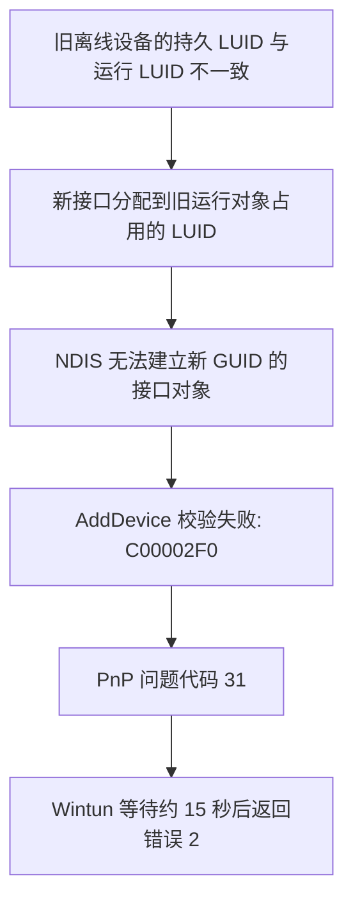

# 虚拟网卡创建故障排查

调查日期：2026 年 11 月 22 日。故障环境为本机 Windows 11（真实版本 `10.0.22621`），用户报告的版本为 LLRemote 0.1.5。

本机已经确认的故障是：一个已离线的旧 Wintun 设备，持久化的接口标识与 Windows 运行中的接口标识不一致。旧对象占用了新网卡分配到的 LUID，导致 NDIS 无法注册新接口，最终出现设备问题代码 31、`STATUS_OBJECTID_NOT_FOUND` 和 Wintun 创建失败。界面上的“皎月连接口超时”需要结合这个底层错误判断。

单独提升为管理员或 SYSTEM 仍然复现。严格核验并通过 Windows 标准接口移除这一个异常离线设备后，底层网卡创建和会话启动连续三次成功。旧对象最初为何形成错误映射，现有证据尚不能确定；实际 SDK 开启接受控制和双机组网、串流仍须单独验收。

## 1. 失败位置和错误含义

直接调用随包 `engines/Jiaoyuelian/network.dll` 的 Wintun API，排除前端请求和 Sunshine 后，管理员进程仍在约 15.2 秒后失败。DLL 加载和 API 解析均成功，日志进入了真实的 `Creating adapter` 阶段。

```text
Using existing driver 0.14
Creating adapter
Timed out waiting for device query: ... (Code 0x00000102)
Failed to setup adapter (problem code: 0x1F, ntstatus: 0xC00002F0): ... (Code 0x00000002)
```

| 证据 | 含义 |
| --- | --- |
| `0x00000102` | 等待 PnP 设备就绪超时，不能单凭此项归因于皎月连服务器或网络请求 |
| problem `0x1F` / 31 | `CM_PROB_FAILED_ADD`，设备添加阶段失败 |
| NTSTATUS `0xC00002F0` | `STATUS_OBJECTID_NOT_FOUND`，本轮在 NDIS 查找接口对象时产生 |
| Win32 `2` | Wintun 最终返回的错误，不能据此断定 `network.dll` 或驱动文件缺失 |

对应原始调用记录见 [elevated.json](../.work/wintun-diagnostic/elevated.json)。原始日志含本机中文错误字符串，分析以未受编码显示影响的数值错误码为准。

## 2. 权限、位数和驱动对照实验

各轮使用独立诊断进程；表中时间是底层创建调用耗时。

| 对照条件 | 创建耗时 | 创建结果 | 记录 |
| --- | ---: | --- | --- |
| 普通用户，x86 | 0 ms | 错误 5；私有命名空间、安装互斥锁访问被拒绝 | [ordinary.json](../.work/wintun-diagnostic/ordinary.json) |
| 管理员，x86 | 15203 ms | 错误 2、问题代码 31、`C00002F0` | [elevated.json](../.work/wintun-diagnostic/elevated.json) |
| 管理员，x64 | 15187 ms | 同类错误 | [elevated-x64.json](../.work/wintun-diagnostic/elevated-x64.json) |
| LocalSystem，x86 | 15125 ms | 同类错误 | [system.json](../.work/wintun-diagnostic/system.json) |
| 显式启动 NetSetupSvc | 15172 ms | 同类错误 | [service-started.json](../.work/wintun-diagnostic/service-started.json) |
| 临时补充 Installer32 后再试 | 15188 ms | 同类错误 | [installer-trial.json](../.work/wintun-diagnostic/installer-trial.json) |
| 预先启动 Wintun 驱动服务 | 15172 ms | 同类错误 | [driver-started.json](../.work/wintun-diagnostic/driver-started.json) |

权限不足确实会使创建失败，但其特征是立即返回错误 5。管理员、SYSTEM 和两种进程位数均不能消除本次约 15 秒的接口注册失败，所以“继续提高软件执行权限”不能单独解决本机故障。

本轮另核对了已安装的 AMD64 `wintun.sys`：它与 DLL 内嵌的驱动资源逐字节一致，版本为 0.14，Microsoft WHQL 签名有效。没有观察到针对 Wintun 的 CodeIntegrity 拦截；本机 HVCI 为 0。这些核对支持继续检查接口注册过程，未建立驱动签名或文件缺失导致本次失败的证据。

## 3. 持久接口和运行接口的标识冲突

异常旧设备的 SDK GUID 为 `{00000622-FFFF-FFFF-FFE9-76E58C74063E}`，实例为 `SWD\WINTUN\{00000622-FFFF-FFFF-FFE9-76E58C74063E}`。修复前核验其 `Present=False`，类型为 Wintun，`IfType=53`。

| 对象与数据来源 | NetLuidIndex | 完整 LUID | 结果 |
| --- | ---: | --- | --- |
| 旧 SDK GUID 的持久记录 | 32768 | `0x0035008000000000` | 与运行时映射不一致 |
| 旧 SDK GUID 的运行接口表 | 32770 | `0x0035008002000000` | LUID → GUID 和 GUID → LUID 均成功，并指向旧 SDK GUID |
| 新随机 GUID 的持久记录 | 32770 | `0x0035008002000000` | 新接口获得了已被旧运行对象占用的 LUID |
| 新随机 GUID 的运行查询 | — | — | GUID → LUID 连续返回错误 87，未完成正确注册 |
| 现有 LetsTAP 的运行映射 | 32769 | `0x0035008001000000` | 正常，可作为相邻编号的对照 |

这里的编号是 `NET_LUID.Info.NetLuidIndex`，不是 Windows 的 `ifIndex`。LUID 还包含接口类型；仅比较网卡名称或 GUID 是否出现在注册表中，无法识别这个冲突。

[reverse-luid-snapshot.json](../.work/wintun-diagnostic/reverse-luid-snapshot.json) 记录了完整双向查询结果。[interface-snapshot-summary.json](../.work/wintun-diagnostic/interface-snapshot-summary.json) 记录了失败的新 GUID `{C5A4F384-B4CB-4A1D-80D8-D2E3B5231F46}`、类键 `0016`、`IfType=53`、`NetLuidIndex=32770`，以及多次查询失败。

## 4. 内核证据与因果链

本轮使用与本机 `C:\Windows\System32\drivers\ndis.sys` 匹配的 Microsoft PDB。PDB 标识为 `0BCED216F6EAE2A4D2117B7E2D58B4C4`，age 为 1。以下地址均为该二进制的 RVA，不能直接套用到其他 Windows 构建。

1. `ndisIfCreateInterfaceFromPersistentStore` 先按持久化 LUID 查找现有接口对象。若 LUID 已被占用，分支 `0x42fd4` 返回 `STATUS_UNSUCCESSFUL`（`0xC0000001`），阻止新 GUID 对应的对象完成创建。见 [持久接口创建代码](../.work/wintun-diagnostic/ndis-symbols/ndisIfCreateInterfaceFromPersistentStore.asm.txt) 和 [冲突分支](../.work/wintun-diagnostic/ndis-symbols/persisted-fastpath.asm.txt)。
2. `ndisPnpRefresh` 调用 `ndisIfCreateOrUpdateInterface` 后没有检查其返回值。因此 NetSetup 插件 API 103 或刷新 IOCTL 返回成功，不能证明运行接口已经注册。见 [刷新入口](../.work/wintun-diagnostic/ndis-symbols/ndisPnpRefresh.asm.txt)。
3. 现有接口的刷新路径更新名称、标志和所属网络等字段，没有纠正 `_NDIS_IF_BLOCK.NetLuid`。反复刷新已有 GUID 不能据此保证修复错误 LUID。见 [已有接口更新代码](../.work/wintun-diagnostic/ndis-symbols/ndisIfUpdateIfBlockFromPersistedState.asm.txt)。
4. `ndisAddDevice` 起始于 `0x14a400`。它在 `0x14ae36` 调用 `ndisIfFindInterfaceByInterfaceGuid`，随后校验 `_NDIS_IF_BLOCK.NetLuid`（字段偏移 `0x520`）。GUID 对象缺失，或对象中的 LUID 与待添加设备不匹配，都会转到 `0x150253` 设置 `0xC00002F0`。见 [设备添加代码](../.work/wintun-diagnostic/ndis-symbols/ndisAddDevice.asm.txt)、[失败分支](../.work/wintun-diagnostic/ndis-symbols/add-device-failure-path.asm.txt) 和 [PDB 类型布局](../.work/wintun-diagnostic/ndis-symbols/layouts.json)。
5. NDIS ETW 的 `AddDeviceFailed` 实际记录了 `failureReason=4`、`ntStatus=0xC00002F0`、`networkLuid=0x35008002000000`。随后 PnP 问题代码 31 和 Wintun 超时、错误 2 与上述失败路径吻合。见 [原始 ETW XML](../.work/wintun-diagnostic/verbose-2ec01947e6f545ea9d4321474619484f/trace-0.xml)。该轮随机 GUID 为 `{7711E407-8B08-4095-AE45-5E39F4819D1F}`，与接口快照属于不同轮次，不能当作同一个设备实例。



## 5. 本轮实施的定向修复

先备份并核对唯一目标：SDK GUID 和设备实例匹配，驱动确为 Wintun，`IfType=53`，设备已离线，且持久 LUID 与运行 LUID 不同。全部条件满足后，使用管理员上下文调用 Windows 标准的单设备移除接口：

```powershell
pnputil /remove-device 'SWD\WINTUN\{00000622-FFFF-FFFF-FFE9-76E58C74063E}'
```

本轮移除返回码为 0。没有用批量网络重置代替目标核验，也没有直接改写持久 LUID。完整核验、备份及移除结果见 [修复记录](../.work/wintun-diagnostic/persistent-37756fb2d3e24041ad6bba37acd22279/summary.json)。

NDIS 在持久 Properties 消失后的刷新删除路径中，会对符合 `Source=1` 的对象调用 `ndisIfDeregisterInterfaceEx(ifIndex, 1)`；后续清理是异步的。见 [创建、更新、删除入口](../.work/wintun-diagnostic/ndis-symbols/ndisIfCreateOrUpdateInterface.asm.txt) 和 [注销代码](../.work/wintun-diagnostic/ndis-symbols/interface-delete.asm.txt)。实测在移除后等待 500 ms，旧 GUID 仍能映射到 `0x0035008002000000`。因此本轮证明的是移除后重建恢复，未测定运行缓存具体切换时刻。

| 修复后的调用 | 创建耗时 | 网卡创建 | 会话启动 | 原始记录 |
| --- | ---: | --- | --- | --- |
| 随机 GUID | 265 ms | 成功，错误码 0 | 成功，错误码 0 | [driver-result.json](../.work/wintun-diagnostic/persistent-37756fb2d3e24041ad6bba37acd22279/driver-result.json) |
| 原 SDK GUID，第 1 次 | 172 ms | 成功，错误码 0 | 成功，错误码 0 | [fixed-guid-1.json](../.work/wintun-diagnostic/persistent-37756fb2d3e24041ad6bba37acd22279/fixed-guid-1.json) |
| 原 SDK GUID，第 2 次 | 188 ms | 成功，错误码 0 | 成功，错误码 0 | [fixed-guid-2.json](../.work/wintun-diagnostic/persistent-37756fb2d3e24041ad6bba37acd22279/fixed-guid-2.json) |

三次均为 `adapterCreated=true`、`sessionStarted=true`。随机 GUID 一轮另有清理日志 `Failed to read process output`（`0x6F`），没有否定该轮创建和会话成功；后续两次固定 GUID 记录没有该警告。

## 6. 受保护注册表读取与临时设置恢复

`NetworkSetup2` 的现有 ACL 对普通管理员也可能限制读取。调查使用 SYSTEM 工作进程，仅显式启用 `SeBackupPrivilege`，先枚举确认键已存在，再以 `REG_OPTION_BACKUP_RESTORE` 打开并通过 `RegQueryValueExW` 读取原始类型和字节。没有修改 ACL、所有者或启用 `SeRestorePrivilege`。见 [读取实现](../.work/wintun-diagnostic/persistent-interface-probe.ps1)。

| 临时诊断变更 | 对应轮次的恢复证据 |
| --- | --- |
| 启动 NetSetupSvc、创建 SYSTEM 计划任务 | `ServiceRestored=true`、`TemporaryTaskRemoved=true`：[context-probe-summary.json](../.work/wintun-diagnostic/context-probe-summary.json) |
| 补充 Installer32、开启 NDIS Operational 日志 | 原值分别为不存在、关闭；`RegistryRestored=true`、`NdisLogRestored=true`：[controlled-probe-summary.json](../.work/wintun-diagnostic/controlled-probe-summary.json) |
| 预先启动 Wintun 服务 | 原先停止，测试结束 `ServiceRestored=true`：[driver-start-probe-summary.json](../.work/wintun-diagnostic/driver-start-probe-summary.json) |
| NDIS / UserPnp ETW 会话 | stop / delete 返回 0，`cleanupConfirmed=true`：[ETW 汇总](../.work/wintun-diagnostic/verbose-2ec01947e6f545ea9d4321474619484f/summary.json) |
| 最后修复轮 SYSTEM 任务和 NetSetup / NDIS ETW 会话 | `TaskRemoved=true`、`TraceStopped=true`、`TraceRemoved=true`：[orchestrator.json](../.work/wintun-diagnostic/persistent-37756fb2d3e24041ad6bba37acd22279/orchestrator.json) |

以上标记反映各轮结束时的恢复结果；定向移除异常离线设备是本轮保留的修复动作。

## 7. 持久属性解析补充

本机 NDIS 读取的接口路径为：

```text
HKLM\SYSTEM\CurrentControlSet\Control\NetworkSetup2\Interfaces\{GUID}\Properties
```

同 GUID 的 `Kernel` 数据为可选项。属性键按 `{property-set-GUID}\%04x` 组织，读取子键默认值。属性集 `{a111f1f4-5923-47c0-9a68-d0bafb577901}` 中：

| 属性编号 | 读取要求 |
| --- | --- |
| `0004` | NetLuid，自定义类型 `0xFFFF0009`，8 字节，小端序 |
| `000a` | IfType，自定义类型 `0xFFFF0007`，4 字节 |
| `0010`、`0012` | 必需字符串；与上面两项一样，没有隐含默认值 |
| `000c`、`000e` | 读取失败时可默认为 0 |
| `001e`、通用属性集 F0 的 `0014` | 存在隐含默认值 |
| `004c`、`0154`、`0156`、`0158`、`015a` | 可选项 |

自定义类型需用原始 `RegQueryValueEx` 读取，不能因高级注册表 API 不认识类型就判定值不存在。相关依据见 [属性读取代码](../.work/wintun-diagnostic/ndis-symbols/Ndis_BindRegistry_ReadNetworkInterfaceV2.asm.txt)、[属性键名生成](../.work/wintun-diagnostic/ndis-symbols/GetPkeyName.asm.txt)、[隐含属性列表](../.work/wintun-diagnostic/ndis-symbols/implied-properties.json)，原始基线见 [baseline.json](../.work/wintun-diagnostic/persistent-57734d3b8ea645518bca8fea49c12eea/baseline.json)。

本轮也核对了 NDIS NSI 模块 `{eb004a11-9b1a-11d4-9123-0050047759bc}` 的网络对象表 6、网络隔离区表 7 及默认网络记录。最终可重复验证的原因是上述 LUID 冲突，未将其他网络属性假设作为确定结论。

## 8. 已验证范围与后续验收

已验证：本机故障的底层 Wintun API 复现、内核失败路径、唯一异常离线设备的定向移除，以及随机 GUID 和原 SDK GUID 的网卡创建、会话启动恢复。

0.1.6 已另外通过实际软件流程验证。用户使用新版界面完成账号设置与登录后，本机接受控制成功开启；SDK 返回类型 `2`，表示已登录且服务运行，Sunshine HTTPS 接口返回 `200`，Wintun 设备为 `Present=True / Status=OK`、网络接口为 `Up`。见 [实际接受控制结果](../.work/actual-accept-control-evidence.json)。

同一旧 SDK GUID 此时的设备类 `NetLuidIndex=32768` 与运行时 LUID `0x0035008000000000` 已一致，GUID 查询返回 `0`。见 [实际 SDK 接口一致性](../.work/wintun-diagnostic/actual-sdk-luid-consistency.json)。这是重建后的最终状态，仍不能把删除后 500 毫秒的快照描述成已立即清空缓存。

仍需验证：另一台电脑连接后的组网、Sunshine / Moonlight 配对和串流；重新启动软件及 Windows 后是否持续恢复。当前接受控制服务保持开启，未为了补充重启测试而中断用户当前软件。

工作区原始证据保存在 `.work/wintun-diagnostic`。本文的原始证据链接用于本工作区审阅；发布目录提供 [0.1.6 验证摘要](validation/0.1.6.json)，不复制含系统接口属性的完整原始采样。
