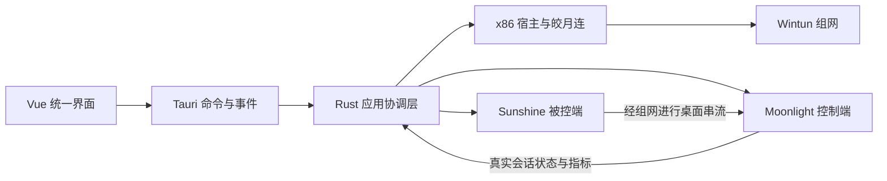

# LL远程初版项目总结

记录日期 2026-11-28（上海时区）。当前版本为 0.1.16，产品方案为 V1.3。

0.1.16 增加公网和局域网 IP 直连，并修正在线设备显示名称和签到时长。在线列表与在线详情显示皎月连目录主机名及对应备注。签到页读取官网日期并按账号保存，账号页用系统时间计算剩余服务时长，旧版缺少日期时提示打开签到页。[0.1.16 说明](releases/0.1.16.md)

0.1.15：用户确认缩略图定位修正版功能测试通过，现已更新本机 release 并发布 GitHub v0.1.15。移除全部设备入口/页面，保留设备资料；历史与收藏只将左侧图标换成壁纸缩略图，保留其余资料与时间。沿用已验收功能代码，更新版本配置后重新构建和校验，不重新运行应用或内核测试。个人 Data、配置和配对保留；按用户本轮要求不核对旧版本，最终交付、下载复核与清理结果见 [0.1.15 记录](validation/0.1.15.json) 和 [发布回执](releases/0.1.15-publication.json)。以下候选记录保留为实现历史。

最新反馈与修正：用户指出上一候选的壁纸覆盖整行，明确只替换列表左侧图标，保留右侧名称、连接信息和时间。原因是复用图片继承详情页绝对定位；此次仅限定缩略图容器并重置其内部图片定位，列表资料与功能沿用原有布局。构建、生成 CSS 检查及包校验通过，本机 release 的程序、ZIP 和校验文件已更新，390 个原有保留文件哈希不变，临时输出已清理。不运行单元、网页、桌面或内核测试；最新交付与待验范围见 [缩略图定位修正记录](validation/0.1.14-thumbnail-layout-fix.json)。

最新界面修正：用户明确移除「全部设备」入口和页面，保留设备资料；侧栏在线条目继续可用，默认及旧页面跳转改为开始协助并保留首次使用引导。连接记录、收藏共用较大的设备壁纸缩略图，未设置时显示默认图。构建与包校验已完成，本机 release 的程序、干净 ZIP 和校验文件已更新；389 个原有 Data、配置及其他保留文件哈希不变，临时输出已清理。新界面待用户运行验收，公开 GitHub 资源保持此前版本。见 [本轮记录](validation/0.1.14-navigation-thumbnails.json)。

11-25 用户规定：release 以外的临时交付包、ZIP 和程序备份，编译/包校验并同步 release 后删除；专门上传 GitHub 的材料上传成功后删除。后续临时打包统一 `.work/package-current/`，早期目录不再写入。规则覆盖历史保留临时副本的做法，不删除源码、工具、用户数据或原始诊断。清理记录见 [目录盘点](0.1.14目录与备份盘点.md)。

2026-11-25 修正同账号设备重连目录 ID 变化导致新资料没有壁纸的问题。保留独立目录名称，在名称唯一、旧 ID 没有其他在线引用且 UUID 无冲突时衔接原资料；保留壁纸、收藏和全部历史引用，已确认 UUID 继续用于连接身份核对。同设备在线详情、多条连接记录详情及收藏详情共用同一壁纸，任一入口修改均更新该资料。实现阶段仅构建和包校验；用户随后测试反馈功能正常并授权更新 GitHub，同版本 0.1.14，附件保留原始文件名且无中文 label。本轮沿用验收 EXE，不运行单测、桌面或内核，个人 Data 不修改。见 [本轮记录](validation/0.1.14-wallpaper-reconnect.json)。

0.1.14 增加地址相同时的自动角色切换及未开启时的询问弹窗。恢复在真实断开并清理后延迟至少 3 秒，再核对会话、重连、进程和组网状态；设置引起的内部 Moonlight 重启保留暂停。性能卡片定位到 Moonlight 客户区右下角。用户指定自行运行测试，本次仅编译和包校验，见 [0.1.14 记录](validation/0.1.14.json)。旧版交付、Data 和配对保留。
原 0.1.14 候选收到用户问题：移动 Data 后 Sunshine 创建旧版目录，全屏连接不显示悬浮球。修正版更新随包 Sunshine 的旧绝对路径、调整悬浮窗口创建与显示、默认关闭性能监测，并按追加要求让新连接默认窗口模式；同版本重新打包并保留本机 Data，用户随后反馈当前测试无问题并授权发布。

0.1.13 更新：修复壁纸保存后本地资源读取 403，上传上限改为 5 MB，默认关闭窗口到托盘，码率数值按钮每步 1 Mbps。新便携目录与 ZIP 独立生成，旧 0.1.12 和 Data 保留。功能运行测试由用户完成，编译与包校验见 [0.1.13 记录](validation/0.1.13.json)。以下初版使用确认和历史验证事实继续对应 0.1.12。

同日用户确认 0.1.13 功能测试通过，并要求补充恢复默认/更换壁纸保存后的旧文件清理、保留默认图。该清理逻辑使用隔离临时文件检查；版本号保持 0.1.13，最终干净便携资源独立制作并上传 GitHub Releases。本机旧目录、ZIP 和 Data 保留。

用户随后要求本机 0.1.13 也替换为最终程序与 ZIP。现已按此要求同步更新，保留 Data、配置和配对信息，替换前的程序/ZIP 留有本机备份；0.1.12 原样保留。

LL远程是一款 Windows 远程桌面软件，将皎月连、Sunshine 和 Moonlight 整合到一个统一界面中。用户可以管理同账号电脑、通过识别码协助他人、开启本机接受控制，并在远程会话中调整画质、输入和声音设置。

当前项目已经完成可正常使用的初版，这是项目拥有者在本次总结中的使用确认。已有交付目录、生产构建、真实内核接入和持续迭代记录，后续工作可以围绕现有产品修复、完善和扩展。具体跨电脑环境、长时间运行及干净系统的完整测试矩阵尚未全部归档，不能把这次使用确认扩大为所有环境均已验证。

给接手者的资料入口：[AI 接手指南](AI接手指南.md)、[版本演进记录](版本演进记录.md)、[README](../README.md)。

## 1. 项目解决的问题

2026-11-24 用户确认「目前测试没有问题」，授权发布最新 0.1.14 源码与资源。该反馈未附逐项场景矩阵，本轮不重新运行测试；以原验收 EXE 制作空 Data 发布包，附修复内容与面向下载用户的 Data 升级提醒。整个 Data 在同机同 Windows 用户下迁入新版可沿用配置及配对，跨机器/用户需要重新认证加密凭据。个人 Data 不上传，旧公开版本保留。

同版本继续补充：收藏与历史共用可高亮的卡片列表，悬停出现删除按钮，点击直接硬删除主机资料及全部对应历史/收藏；恢复备份同步更新，无引用的受管理授权和自定义壁纸清理。失去设备资料的旧历史隐藏。升级保留 Data，用户在应用内明确删除的目标按新规则处理，用户现已确认当前测试无问题。
当前 0.1.14 另追加独立连接记录功能：侧栏「我的设备」和全部设备页仅显示同账号在线目录主机，旧连接资料继续保留。左侧开始协助下方的「连接记录」以时间倒序卡片列表展示，可高亮、进入详情及返回；记录不展示主机状态，详情名称右侧星标直接收藏并显示黄色。保持 0.1.14，同版本更新前备份程序和 ZIP，保留 Data、配置和配对；实现阶段只编译及包校验，之后用户确认当前版本测试无问题。

原来使用组网和串流工具时，用户需要分别处理账号登录、被控端服务、主机地址、PIN 配对和串流设置。LL 将这些步骤串起来，并负责设备记录、错误提示、凭据保存和应用生命周期，让用户从一个界面完成常用远控操作。

| 使用场景 | 初版提供的行为 |
| --- | --- |
| 控制自己的电脑 | 两端登录同一皎月连账号，从当前设备列表选择目标，取得对端地址后连接 |
| 协助其他人 | 被控端开启接受控制，分享识别码、连接密码和组网地址；控制端填写信息并连接 |
| 首次连接 | 控制端显示四位 PIN，被控端在全局弹窗中确认并填写设备名 |
| 后续重连 | 复用有效配对证书，核对已确认的 Sunshine 主机身份，保留设备偏好 |
| 日常设备管理 | 设备列表、收藏、昵称、壁纸、连接历史和快速启动应用 |
| 会话内操作 | 分辨率、帧率、码率等画质设置，窗口/全屏/无边框切换，鼠标模式、声音及性能显示 |
| 被控端常驻 | 接受控制开关、可选“始终接受控制”、托盘、防休眠和可选开机登录启动 |

账号页及诊断页展示内核实际提供的状态。皎月连接口没有可确认的余额字段，当前明确显示无法读取；没有实际串流数据时，性能面板不填入示例指标。

## 2. 三个内核和 LL 的职责

| 层 | 技术或组件 | 职责 |
| --- | --- | --- |
| 用户界面 | Vue 3、TypeScript、Pinia、Vue Router | 页面、表单、设备管理、状态反馈、会话控制界面 |
| 桌面容器 | Tauri 2、系统 Evergreen WebView2 | 原生窗口、前后端命令、托盘及界面运行 |
| 应用协调 | Rust | 连接状态机、组件管理、凭据、持久化、Windows 权限与错误处理 |
| 组网 | 皎月连 v1.06 | 账号、设备目录、识别码连接和 Wintun 虚拟网络 |
| 被控端 | Sunshine v2026.914.233613 | 主机采集、编码、应用提供、账号管理及 PIN 配对 |
| 控制端 | Moonlight v6.2.0 + LL 管理扩展 | 串流接收、解码、显示、输入和原生串流设置 |
| 兼容宿主 | LLRemote.EngineHost.exe，x86 C++ | 加载原皎月连 DLL，与 x64 主程序配合 |

LL 的主要价值在于统一交互、流程协调和 Windows 环境适配。串流协议、编解码和组网内核沿用已有组件，继续开发时要保留它们的接口及行为约束。

## 3. 已经形成的核心流程

主动连接经过：建立皎月连连接 → 取得对方组网地址 → 检查 Sunshine 可达性与主机身份 → 首次 PIN 配对或复用证书 → 启动 Moonlight → 确认实际渲染帧 → 显示会话控制。

接受控制时，当前版本并行启动皎月连和 Sunshine；偏好保存后，后台准备限定到实际组网接口的 Windows 防火墙访问。防火墙调整失败单独报告，已成功启动的服务保持运行，但对方能否连接仍取决于真实网络与规则状态。

状态变化通过 Rust 事件更新界面。表单草稿和正在执行的操作独立处理，后台刷新不得清空密码、覆盖编辑内容或把旧账号的迟到响应应用到新账号。用户断开或退出时，需要等待实际内核响应并处理停止失败，避免仅修改界面状态。

## 4. 当前交付和使用方式

当前完整目录为 `release/LLRemote-Portable-x64-0.1.12/`，公开下载见 [0.1.12 GitHub Releases](https://github.com/chuanK6/LL-Remote/releases/tag/v0.1.12)。本机同名原 ZIP 包含运行后的个人数据，已原样保留；发布的 ZIP 使用另行制作的干净副本。将下载包完整解压后运行其中的 `LLRemote.exe`，按提示接受 Windows 管理员授权。

运行目录携带三个内核及 DLL、Qt、Web 和 MSVC 资源；WebView2 使用 Windows 的系统共享运行时，未安装时提示打开微软安装页。程序旁的 `Data` 保存便携版数据和 WebView2 缓存。非便携模式使用当前用户的 `%LOCALAPPDATA%/LLRemote`。

首次使用先完成 Sunshine 账号设置，再登录皎月连。现有主机与配对优先复用。0.1.12 的首次配对设备名默认是可修改的 `roth`，确认时需要填写。默认启用防休眠；自启动、关闭窗口进入托盘和始终接受控制默认关闭，可由用户在设置中选择。

当前用户已经确认初版可正常使用。使用体验结论与自动验证结果分别记录，便于后续定位某台电脑、某个功能或某次升级的问题。

## 5. 初版迭代的主要成果

从 0.1.0 到 0.1.12，迭代集中解决了五类问题：

1. 首次使用和身份确认：Sunshine 服务权限、账号状态同步、引导返回入口，以及 PIN 配对和证书落盘。
2. Windows 原生适配：中文路径、受限 DLL 搜索、x86 宿主、管理员权限和 Wintun 网卡故障诊断。
3. 网络可达性：正确区分本机与对端地址，处理组网接口和 Sunshine 防火墙规则，避免后台失败回滚已经启动的服务。
4. 操作连续性：接受控制失败后的真实清理、密码输入保持、账号隔离、同账号设备同步、断开和退出的组件处理。
5. 使用体验：窗口拖动缩放、会话模式切换、悬浮球跟随、画质设置统一和设置即时保存。

各版本的触发问题、改动和验证范围见 [版本演进记录](版本演进记录.md)。V1.3 是产品方案修订号，与软件的 0.1.x 版本号分别管理。

## 6. 项目现状与后续工作

| 项目 | 当前结论 |
| --- | --- |
| 产品状态 | 项目拥有者确认：初版已完成，可以正常使用 |
| 前端生产构建 | 2026-11-23 清理后 `npm run build` 通过，含 TypeScript 检查 |
| 当前便携包资源 | 138 个原生二进制、1,597 个资源文件校验通过，缺失依赖为 0 |
| 最新前端单元测试 | 清理后运行结果为 31 通过、3 失败，另有 7 次未处理异常；尚待维护 |
| 历史 0.1.11 验证 | 34 项前端单元、16 项浏览器、54 项 Rust 单元及真实本机环回串流验证，详见原记录 |
| 0.1.12 验证记录 | 已记录生产构建及便携包；实际运行验收由用户完成，本次用户确认补充了“初版可用”结论 |
| 应用下载 | 0.1.12 已发布 GitHub Releases，附干净便携 ZIP 与 SHA-256 文件；程序资源未更改 |
| 发布准备 | 公开再分发授权、全部依赖源码材料、签名与正式发布流程尚需完善 |

最新单测问题来自两处测试替身缺少 `listenOperationError`，以及配对测试仍预期空设备名，与当前默认名称不一致。相关源码和测试文件在工作区清理前后未改变；历史版本通过记录不能替代当前版本的测试结果。后续应先按当前产品行为维护这些测试，再扩大功能改动。

下一阶段适合优先处理测试同步、用户实际环境的复现记录、双电脑和混合 DPI 多屏验证、真实断网恢复、托盘长期运行、休眠/重启及干净 Windows 安装。已有本机验证中网络控制使用协议测试服务的场景，应继续单列，不能记作真实跨电脑组网验证。

2026-11-23 已清理约 22.17 GiB 的可再生成缓存和重复产物，保留源码、SDK、依赖、当前程序和用户数据，32,471 个保留项比对通过。工作区当时约 5.49 GiB；后续 Rust/Moonlight 构建会重新生成缓存，首次耗时增加。详见 [工作区清理清单](工作区清理清单.md)。

## 7. 项目资料分工

| 资料 | 接手者用它解决什么问题 |
| --- | --- |
| [AI 接手指南](AI接手指南.md) | 找代码入口、启动开发、选择验证方式、保护用户数据 |
| [版本演进记录](版本演进记录.md) | 理解每个版本修复了什么、哪些旧行为已被替换 |
| [README](../README.md) | 当前运行和构建入口 |
| [V1.3 产品方案](LL远程-软件方案.md) | 理解产品目标和原交互设计 |
| [开发与验收记录](开发与验收记录.md) | 查询原始修复说明及历史验证范围 |
| [连接流程与组网地址](连接流程与组网地址.md) | 排查地址、首次配对和 Sunshine 可达性 |
| [虚拟网卡创建故障排查](虚拟网卡创建故障排查.md) | 查询已确认的 Wintun/NDIS 根因和原始证据 |
| [第三方组件说明](../notices/THIRD-PARTY-NOTICES.md) | 查询组件来源及再分发注意事项；其中固定 WebView2 行属于旧交付信息 |

本总结是初版交接快照。修改行为、发布新版本或补充实机验收后，应同步更新相关文档及验证记录。
